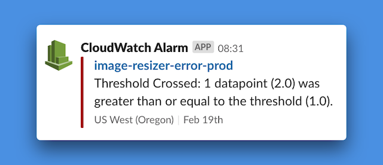

# cloudwatch-alarm-to-slack

Slack bot that maps AWS CloudWatch Alarms into Slack messages.

## Setup

- Clone the repository and run `npm install`
- Ensure your [AWS credentials are available](https://serverless.com/framework/docs/providers/aws/guide/credentials/)
- Configure a Slack [Incoming Webhook](https://slack.com/apps/manage/custom-integrations)
- Deploy with `ENVIRONMENT=your-env DEPLOYMENT_BUCKET=your-bucket npm run deploy`
- Once deployed, configure CloudWatch Alarm Actions to send notifications to the topic this stack creates

## Moving to another Slack workspace

The destination workspace is whichever one owns the webhook in
`SLACK_WEBHOOK_URL`, so moving workspaces is a redeploy with a new value and no
code change. For the NMI migration that means creating an incoming webhook on
the NMI side, pointing the environment at it, and redeploying.

Every alarm in the environment moves at once, so do it per environment rather
than all at once, and confirm afterwards by publishing to the stack's SNS topic
or by pushing a low-stakes alarm into ALARM state. A webhook that is valid but
belongs to the wrong channel still returns 200, so a successful deploy is not by
itself evidence that alarms landed where you intended.

## Developing

- Run tests, `npm test`
- Invoke locally, `npm run invoke`
